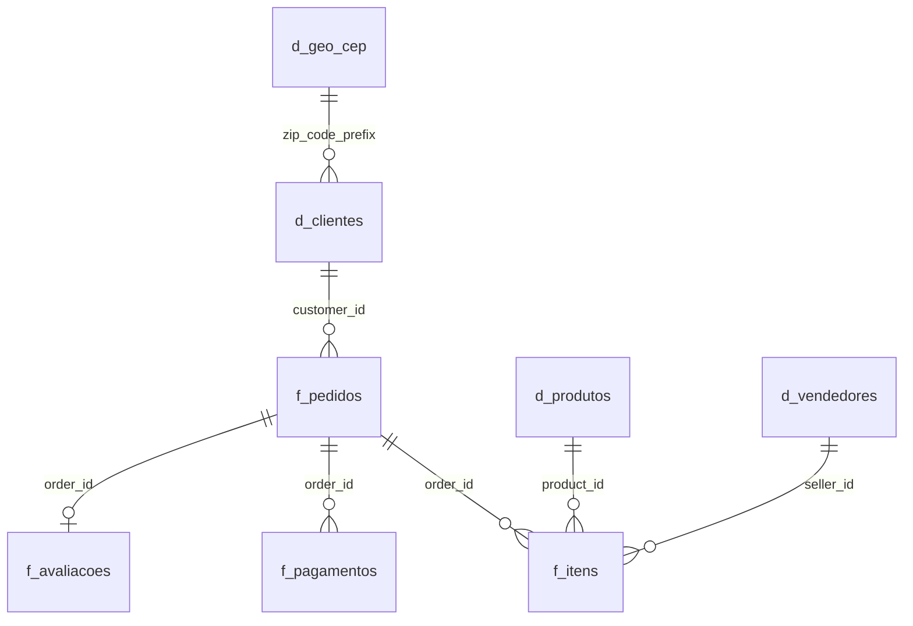

# Olist | Painel Executivo de E-commerce

Atividade da **Fase 1 do Tech Challenge – Pós-graduação em Agentes de IA (FIAP)**.

Painel executivo em Tableau sobre a base pública de e-commerce da Olist. O objetivo é entender rapidamente os principais problemas da operação e mapear quais deles podem ser resolvidos com **agentes de IA** nas próximas fases.

> **Painel interativo (Tableau Public):** _cole aqui o link depois de publicar_
>
> **Arquivo do painel:** [`dashboard/Olist_Painel_Executivo.twbx`](dashboard/Olist_Painel_Executivo.twbx) (abre no Tableau Desktop ou no Tableau Reader, com os dados embutidos)

<!-- Para mostrar a imagem do painel: no Tableau, Painel > Exportar imagem..., salve como docs/img/painel.png e troque esta linha por:  -->

---

## 1. Contexto e pergunta de negócio

A Olist conecta pequenos vendedores aos grandes marketplaces brasileiros. A base contém cerca de **100 mil pedidos** entre 2016 e 2018, com informações de clientes, vendedores, produtos, pagamentos, entregas e avaliações.

**Pergunta:** onde a operação perde valor (satisfação, recompra, receita) e quais desses pontos são bons candidatos para automação com agentes de IA?

O painel é um **rascunho exploratório**, focado em diagnóstico e não em produto final.

## 2. Dados

- **Fonte:** [Brazilian E-Commerce Public Dataset by Olist (Kaggle)](https://www.kaggle.com/datasets/olistbr/brazilian-ecommerce), licença CC BY-NC-SA 4.0.
- **Período analisado no painel:** jan/2017 a ago/2018. Os meses de 2016 e de set–out/2018 estão incompletos e foram filtrados por padrão.
- **9 arquivos originais:** pedidos, itens, pagamentos, avaliações, clientes, vendedores, produtos, tradução de categorias e geolocalização.

### Modelo de dados (relacionamentos)



| Tabela | Grão | Tratamento |
|---|---|---|
| `f_pedidos` | 1 linha por pedido | Status em português, dias de entrega, dias de atraso, faixa de atraso, flag de atraso, flag de postagem atrasada do vendedor, valores agregados |
| `f_itens` | 1 linha por item | Valor total do item (produto + frete) |
| `f_pagamentos` | 1 linha por parcela | Sem alteração |
| `f_avaliacoes` | 1 linha por pedido | 547 pedidos tinham mais de uma avaliação; ficou só a mais recente |
| `d_clientes` / `d_vendedores` | 1 linha por cliente/vendedor | Região do Brasil adicionada |
| `d_produtos` | 1 linha por produto | Categoria traduzida e com nome legível; 2 categorias sem tradução corrigidas |
| `d_geo_cep` | 1 linha por prefixo de CEP | A base original tinha ~1 milhão de linhas para 19 mil CEPs; agregada com lat/long mediana |

### Base única do painel

Para o Tableau, as tabelas foram unidas em uma **base única no grão de item** (`olist_base.csv`, ~113 mil linhas). As métricas de pedido (atraso, nota, prazo, valor pago) ficam **apenas na primeira linha de cada pedido**, para que médias e somas não contem o mesmo pedido mais de uma vez. O dicionário completo está em [`docs/dicionario_de_dados.md`](docs/dicionario_de_dados.md).

## 3. O painel

### Indicadores (linha superior)

| KPI | Valor (jan/17–ago/18, pedidos válidos) |
|---|---|
| Receita de produtos | R$ 13,45 mi |
| Pedidos válidos | 97.910 |
| Ticket médio | R$ 160,18 |
| Nota média | 4,12 |
| Entregas atrasadas | 6,8% |
| Taxa de recompra | 3,2% |

Cores: valores em **laranja/vermelho** indicam pontos de atenção.

### Visualizações

| Gráfico | O que mostra | Destaque visual |
|---|---|---|
| Receita mensal | Evolução da receita de produtos | Black Friday (nov/17) em azul |
| Nota por dias de atraso | Nota média por faixa de atraso | Azul = no prazo, laranja = leve, vermelho = grave |
| Desempenho por região | Prazo médio de entrega por região | Vermelho = atraso acima de 10% |
| % de entregas atrasadas por mês | Tendência de atraso; a nota do mês aparece no tooltip | Linha vermelha |
| Estados | % de entregas atrasadas por UF | Vermelho ≥ 12%, laranja 8–12% |
| Top 10 categorias | Receita por categoria | Laranja = nota média abaixo de 4,05 |

### Funcionalidades

- **Filtros globais** (aplicam-se a todos os gráficos): período da compra, região, UF, categoria, status do pedido e meio de pagamento. Status já vem sem "Cancelado" e "Indisponível".
- **Filtro por clique:** clicar em um estado, uma categoria ou uma região filtra o painel inteiro; clicar de novo limpa a seleção.
- **Tooltips** com métricas extras (pedidos, prazo, nota, frete/produto).
- **Campos calculados** reutilizáveis: Receita, Pedidos, Ticket médio, Nota média, % Entregas atrasadas, % Avaliações negativas, Prazo médio, Frete/produto, % Postagem atrasada, Taxa de recompra (LOD por cliente).
- **Aba extra "Vendedores":** dispersão receita × nota por vendedor.

## 4. Principais achados

1. **Atraso derruba a satisfação.** Nota média de 4,29 quando o pedido chega no prazo, contra 2,1 com 4 a 7 dias de atraso e 1,7 acima de 8 dias.
2. **A operação não aguenta os picos.** O atraso médio é 6,8%, mas chegou a 12,4% na Black Friday de 2017 e a 19% em março de 2018, os meses com as piores notas.
3. **Norte e Nordeste são mal atendidos.** Prazo médio de 20 a 23 dias, contra 11 no Sudeste. O Nordeste tem o dobro de atraso (12,8%). 60% dos vendedores estão em SP.
4. **Parte do atraso nasce no vendedor.** Quando o vendedor posta fora do prazo, 21% dos pedidos chegam atrasados, contra 5,4% quando posta no prazo.
5. **Quase ninguém volta a comprar.** Só cerca de 3% dos clientes fizeram mais de um pedido.
6. **O prazo prometido é conservador.** O cliente vê, em média, 23,7 dias; a entrega real leva 12,5.
7. **Categorias com nota baixa.** Cama, mesa e banho é a 3ª em receita e a que mais gera avaliações negativas em número absoluto.

> Os achados mostram correlações observadas na base histórica, não relações de causa comprovadas.

## 5. Oportunidades para agentes de IA

| Problema | Agente proposto | O que ele faria |
|---|---|---|
| Atraso derruba a nota | **Monitoramento de pedidos em risco** | Cruza prazo de postagem, rota e histórico; avisa o cliente antes do atraso e sugere compensação |
| Picos sazonais | **Planejamento de capacidade** | Prevê demanda por semana e alerta a operação sobre gargalos logísticos |
| Norte/Nordeste | **Otimização logística** | Recalcula prazos por rota e sugere vendedores/transportadoras regionais |
| Vendedor posta atrasado | **SLA do vendedor** | Cobra o vendedor, escala casos recorrentes e mantém um ranking de desempenho |
| Avaliações negativas | **Análise de avaliações** | Lê os comentários, classifica a causa (atraso, produto, embalagem) e abre a tratativa |
| Recompra de 3% | **Pós-venda / CRM** | Envia mensagens personalizadas após a entrega para clientes satisfeitos, com recomendação e cupom |

**Prioridade sugerida:** começar pelo agente de **monitoramento de pedidos em risco**, porque ele atua na causa (a entrega) que se propaga para avaliação e recompra.

## 6. Como reproduzir

```bash
# 1. Baixe os CSVs do Kaggle e coloque em data/raw/
# 2. Instale as dependências
pip install -r requirements.txt
# 3. Gere o modelo dimensional e a base do painel
python src/preparar_dados.py
# 4. Veja os indicadores e achados no terminal
python src/analise_exploratoria.py
```

O painel `dashboard/Olist_Painel_Executivo.twbx` já traz a base embutida; não é preciso rodar os scripts para abri-lo.

## 7. Estrutura do repositório

```
├── dashboard/
│   └── Olist_Painel_Executivo.twbx   # painel Tableau com dados embutidos
├── data/
│   ├── raw/                          # CSVs originais do Kaggle (não versionados)
│   └── processed/                    # saídas de preparar_dados.py (não versionadas)
├── docs/
│   ├── dicionario_de_dados.md
│   └── img/                        # imagem do painel (opcional)
├── src/
│   ├── preparar_dados.py             # limpeza, modelo dimensional e base única
│   └── analise_exploratoria.py       # indicadores e achados
├── requirements.txt
└── README.md
```

## 8. Limitações

- Base histórica (2016–2018); os números não representam a Olist atual.
- Na base única, quando o painel é filtrado por categoria, as métricas de pedido consideram a categoria do primeiro item do pedido. Isso só afeta pedidos com itens de categorias diferentes, que são poucos.
- A taxa de recompra do painel (3,2%) conta todos os pedidos do cliente, inclusive cancelados; no script, com só pedidos válidos, ela fica em 3,0%.

---

**Autora:** Gabriela Alves Monteiro · Pós-graduação em Agentes de IA – FIAP
