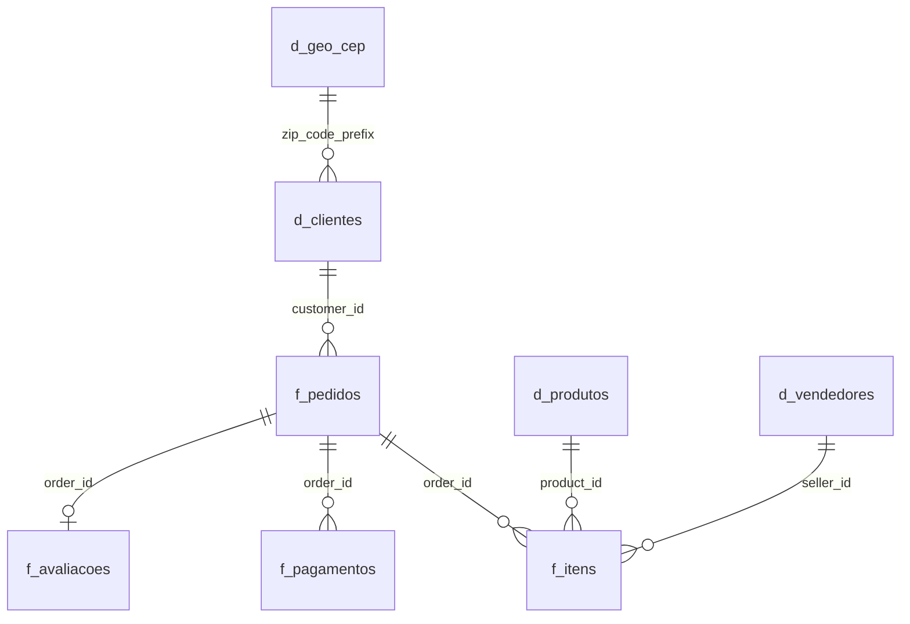

# Olist | Painel Executivo de E-commerce

**Projeto de conclusão de curso** – Tecnologia em Análise e Desenvolvimento de Sistemas, **Faculdade Impacta**
**Disciplina:** Software Product: Analysis

Painel executivo em Tableau sobre a base pública de e-commerce da Olist. O projeto é entregue em **quatro etapas** (AC1, AC2, AC3 e Entrega Final), cada uma com uma nova funcionalidade e uma análise diferente.

> **Painel interativo (Tableau Public):** _cole aqui o link depois de publicar_
>
> **Arquivo do painel:** [`dashboard/Olist_Painel_Executivo.twbx`](dashboard/Olist_Painel_Executivo.twbx) (abre no Tableau Desktop ou no Tableau Reader, com os dados embutidos)

<!-- Para mostrar a imagem do painel: no Tableau, Painel > Exportar imagem..., salve como docs/img/painel.png e troque esta linha por:  -->

---

## Entregas

**Integrante:** Gabriela Alves Monteiro (projeto individual)
**Board do projeto:** https://github.com/users/alvgabi/projects/2
**Tipo de projeto:** projeto de dados (BI e análise de dados)

O projeto foi dividido em 4 entregas. Cada uma apresenta uma nova funcionalidade, uma análise diferente do painel e um vídeo.

| Entrega | Funcionalidade | Pergunta de negócio | Issue | Vídeo |
|---|---|---|---|---|
| **AC1** | Preparação dos dados e painel de Vendas | Como estão as vendas e onde a receita está concentrada? | [#1](https://github.com/alvgabi/olist-painel-executivo/issues/1) | _link_ |
| **AC2** | Análise de Logística e Entregas, com filtro por clique | A Olist entrega no prazo? Onde e quando falha? | [#2](https://github.com/alvgabi/olist-painel-executivo/issues/2) | _link_ |
| **AC3** | Análise de Satisfação e dos comentários das avaliações | O que faz o cliente avaliar mal a compra? | [#3](https://github.com/alvgabi/olist-painel-executivo/issues/3) | _link_ |
| **Entrega Final** | Análise de Clientes e Vendedores e painel integrado | O cliente volta? Como os vendedores influenciam a experiência? | [#4](https://github.com/alvgabi/olist-painel-executivo/issues/4) | _link_ |

---

## 1. Contexto

A Olist conecta pequenos vendedores aos grandes marketplaces brasileiros. A base contém cerca de **100 mil pedidos** entre 2016 e 2018, com informações de clientes, vendedores, produtos, pagamentos, entregas e avaliações.

## 2. Objetivo e pergunta de negócio

Construir um painel executivo que permita a um gestor entender rapidamente o desempenho da operação.

**Pergunta central:** onde a operação perde valor em receita, satisfação e recompra, e o que explica essas perdas?

## 3. Dados

- **Fonte:** [Brazilian E-Commerce Public Dataset by Olist (Kaggle)](https://www.kaggle.com/datasets/olistbr/brazilian-ecommerce), licença CC BY-NC-SA 4.0.
- **Período analisado no painel:** jan/2017 a ago/2018. Os meses de 2016 e de set–out/2018 estão incompletos e foram filtrados por padrão.
- **9 arquivos originais:** pedidos, itens, pagamentos, avaliações, clientes, vendedores, produtos, tradução de categorias e geolocalização.

### Modelo de dados (relacionamentos)



| Tabela | Grão | Tratamento |
|---|---|---|
| `f_pedidos` | 1 linha por pedido | Status em português, dias de entrega, dias de atraso, faixa de atraso, flag de atraso, flag de postagem atrasada do vendedor, valores agregados |
| `f_itens` | 1 linha por item | Valor total do item (produto + frete) |
| `f_pagamentos` | 1 linha por parcela | Sem alteração |
| `f_avaliacoes` | 1 linha por pedido | 547 pedidos tinham mais de uma avaliação; ficou só a mais recente |
| `d_clientes` / `d_vendedores` | 1 linha por cliente/vendedor | Região do Brasil adicionada |
| `d_produtos` | 1 linha por produto | Categoria traduzida e com nome legível; 2 categorias sem tradução corrigidas |
| `d_geo_cep` | 1 linha por prefixo de CEP | A base original tinha ~1 milhão de linhas para 19 mil CEPs; agregada com lat/long mediana |

### Base única do painel

Para o Tableau, as tabelas foram unidas em uma **base única no grão de item** (`olist_base.csv`, ~113 mil linhas). As métricas de pedido (atraso, nota, prazo, valor pago) ficam **apenas na primeira linha de cada pedido**, para que médias e somas não contem o mesmo pedido mais de uma vez. O dicionário completo está em [`docs/dicionario_de_dados.md`](docs/dicionario_de_dados.md).

## 4. O painel

### Indicadores (linha superior)

| KPI | Valor (jan/17–ago/18, pedidos válidos) |
|---|---|
| Receita de produtos | R$ 13,45 mi |
| Pedidos válidos | 97.910 |
| Ticket médio | R$ 160,18 |
| Nota média | 4,12 |
| Entregas atrasadas | 6,8% |
| Taxa de recompra | 3,2% |

Cores: valores em **laranja/vermelho** indicam pontos de atenção.

### Visualizações

| Gráfico | O que mostra | Destaque visual |
|---|---|---|
| Receita mensal | Evolução da receita de produtos | Black Friday (nov/17) em azul |
| Nota por dias de atraso | Nota média por faixa de atraso | Azul = no prazo, laranja = leve, vermelho = grave |
| Desempenho por região | Prazo médio de entrega por região | Vermelho = atraso acima de 10% |
| % de entregas atrasadas por mês | Tendência de atraso; a nota do mês aparece no tooltip | Linha vermelha |
| Estados | % de entregas atrasadas por UF | Vermelho ≥ 12%, laranja 8–12% |
| Top 10 categorias | Receita por categoria | Laranja = nota média abaixo de 4,05 |

### Funcionalidades

- **Filtros globais** (aplicam-se a todos os gráficos): período da compra, região, UF, categoria, status do pedido e meio de pagamento. Status já vem sem "Cancelado" e "Indisponível".
- **Filtro por clique:** clicar em um estado, uma categoria ou uma região filtra o painel inteiro; clicar de novo limpa a seleção.
- **Tooltips** com métricas extras (pedidos, prazo, nota, frete/produto).
- **Campos calculados** reutilizáveis: Receita, Pedidos, Ticket médio, Nota média, % Entregas atrasadas, % Avaliações negativas, Prazo médio, Frete/produto, % Postagem atrasada, Taxa de recompra (LOD por cliente).
- **Aba extra "Vendedores":** dispersão receita × nota por vendedor.

## 5. Análise por entrega

### AC1 – Visão Executiva de Vendas
- A Olist faturou **R$ 13,45 milhões** em produtos com **97.910 pedidos** (jan/17–ago/18), com ticket médio de **R$ 160**.
- A receita cresceu em 2017, teve o pico na Black Friday (nov/17) e **estagnou em 2018**: a média mensal caiu 9% entre jan–mai e jun–ago.
- As **10 maiores categorias concentram 62%** da receita.

### AC2 – Logística e Entregas
- **6,8%** das entregas chegam depois do prazo prometido, com picos de **12,4%** na Black Friday e **19%** em mar/18.
- **Norte e Nordeste** esperam de 20 a 23 dias, contra 11 no Sudeste; o Nordeste tem o dobro de atraso (12,8%).
- O prazo prometido é conservador: o cliente vê **23,7 dias**, mas a entrega real leva **12,5**.

### AC3 – Satisfação do Cliente e Avaliações
- Nota média de **4,1**; **12,8%** dos pedidos entregues recebem 1 ou 2 estrelas.
- O atraso é o principal fator: a nota cai de **4,29** (no prazo) para cerca de **1,7** com mais de 8 dias de atraso.
- **54%** dos comentários negativos falam de entrega; 15% de produto errado ou incompleto; 12% de defeito; 12% de atendimento.

### Entrega Final – Clientes e Vendedores
- Só cerca de **3%** dos clientes fizeram mais de um pedido.
- Os **10% maiores vendedores** concentram **67%** da receita.
- Quando o vendedor posta fora do prazo, **21%** dos pedidos chegam atrasados, contra **5,4%** quando posta no prazo.

> Os achados mostram correlações observadas na base histórica, não relações de causa comprovadas.

## 6. Conclusão e recomendações

As quatro partes formam uma cadeia: **a entrega atrasa → a nota cai → o cliente não volta → a receita estagna.**

Recomendações para a operação:
1. **Planejar a capacidade logística** para datas sazonais, como a Black Friday.
2. **Ajustar o prazo prometido por região**, usando o histórico real de entregas.
3. **Acompanhar o prazo de postagem dos vendedores**, com metas e alertas para quem atrasa com frequência.
4. **Criar ações de pós-venda** para incentivar a segunda compra de clientes satisfeitos.
5. **Revisar as categorias com nota baixa**, como Cama, mesa e banho.

## 7. Como reproduzir

```bash
# 1. Baixe os CSVs do Kaggle e coloque em data/raw/
# 2. Instale as dependências
pip install -r requirements.txt
# 3. Gere o modelo dimensional e a base do painel
python src/preparar_dados.py
# 4. Veja os indicadores e achados no terminal
python src/analise_exploratoria.py
# 5. Análise das avaliações e dos comentários (AC3)
python src/analise_avaliacoes.py
```

O painel `dashboard/Olist_Painel_Executivo.twbx` já traz a base embutida; não é preciso rodar os scripts para abri-lo.

## 8. Estrutura do repositório

```
├── dashboard/
│   └── Olist_Painel_Executivo.twbx   # painel Tableau com dados embutidos
├── data/
│   ├── raw/                          # CSVs originais do Kaggle (não versionados)
│   └── processed/                    # saídas de preparar_dados.py (não versionadas)
├── docs/
│   ├── dicionario_de_dados.md
│   └── img/                        # imagem do painel (opcional)
├── src/
│   ├── preparar_dados.py             # limpeza, modelo dimensional e base única
│   ├── analise_exploratoria.py       # indicadores e achados
│   └── analise_avaliacoes.py         # notas e temas dos comentários negativos
├── requirements.txt
└── README.md
```

## 9. Limitações

- Base histórica (2016–2018); os números não representam a Olist atual.
- Na base única, quando o painel é filtrado por categoria, as métricas de pedido consideram a categoria do primeiro item do pedido. Isso só afeta pedidos com itens de categorias diferentes, que são poucos.
- A taxa de recompra do painel (3,2%) conta todos os pedidos do cliente, inclusive cancelados; no script, com só pedidos válidos, ela fica em 3,0%.

---

**Autora:** Gabriela Alves Monteiro
Tecnologia em Análise e Desenvolvimento de Sistemas – Faculdade Impacta · Disciplina Software Product: Analysis
